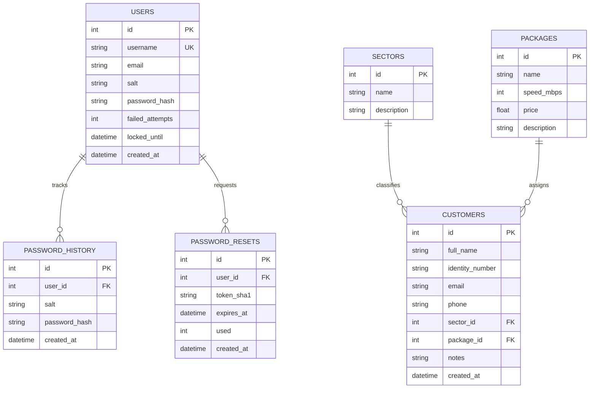

# דו"ח פרויקט סיום בסייבר – מערכת מידע מאובטחת Comunication_LTD

**נושא:** פיתוח מערכת מידע מבוססת ווב ומסד נתונים רלציוני תוך יישום עקרונות פיתוח מאובטח, הדגמת פרצות Stored XSS ו-SQL Injection והטמעת מנגנוני הגנה.  
**גוף מפתח:** חברת תקשורת דמיונית `Comunication_LTD` – שיווק חבילות גלישה באינטרנט.  
**שפת פיתוח:** Python 3.12 / Flask / Jinja2 / SQLite3  
**גרסאות מוגשות:**  
1. `vulnerable_version` (גרסה פגיעה - Port 5001)  
2. `secure_version` (גרסה מאובטחת - Port 5002)  

---

## תוכן עניינים
1. [מבוא ומטרות הפרויקט](#1-מבוא-ומטרות-הפרויקט)
2. [ארכיטקטורת מסד הנתונים הרלציוני](#2-ארכיטקטורת-מסד-הנתונים-הרלציוני)
3. [חלק א' – יישום עקרונות פיתוח מאובטח (Secure Coding)](#3-חלק-א--יישום-עקרונות-פיתוח-מאובטח)
   - [3.1 מסך Register עם HMAC + Salt](#31-מסך-register-עם-hmac--salt)
   - [3.2 קובץ קונפיגורציה לניהול מדיניות סיסמאות](#32-קובץ-קונפיגורציה-לניהול-מדיניות-סיסמאות)
   - [3.3 מסך שינוי סיסמה והיסטוריית 3 סיסמאות](#33-מסך-שינוי-סיסמה-והיסטוריית-3-סיסמאות)
   - [3.4 מסך Login ובקרת ניסיונות כושלים](#34-מסך-login-ובקרת-ניסיונות-כושלים)
   - [3.5 מסך מערכת לניהול לקוחות, חבילות וסקטורים](#35-מסך-מערכת-לניהול-לקוחות-חבילות-וסקטורים)
   - [3.6 מסך שכח סיסמה עם טוקן אקראי ב-SHA-1](#36-מסך-שכח-סיסמה-עם-טוקן-אקראי-ב-sha-1)
4. [חלק ב' – תרחישי תקיפה (XSS + SQLi) ומנגנוני ההגנה](#4-חלק-ב--תרחישי-תקיפה-ומנגנוני-ההגנה)
   - [4.1 מתקפת Stored XSS (סעיף 4) וההגנה עליה](#41-מתקפת-stored-xss-סעיף-4-וההגנה-עליה)
   - [4.2 מתקפת SQLi במסך Login (עקיפת אימות) וההגנה עליה](#42-מתקפת-sqli-במסך-login-עקיפת-אימות-וההגנה-עליה)
   - [4.3 מתקפת SQLi במסך Register וההגנה עליה](#43-מתקפת-sqli-במסך-register-וההגנה-עליה)
   - [4.4 מתקפת SQLi במסך המערכת (UNION Injection) וההגנה עליה](#44-מתקפת-sqli-במסך-המערכת-union-injection-וההגנה-עליה)
5. [השוואת קוד: גרסה פגיעה מול גרסה מאובטחת](#5-השוואת-קוד-גרסה-פגיעה-מול-גרסה-מאובטחת)
6. [תוצאות מבדקי האבטחה האוטומטיים (Test Audit Suite)](#6-תוצאות-מבדקי-האבטחה-האוטומטיים)
7. [סיכום ומסקנות](#7-סיכום-ומסקנות)

---

## 1. מבוא ומטרות הפרויקט
במסגרת פרויקט זה פותחה מערכת מידע מלאה לחברת `Comunication_LTD`, המשווקת חבילות גלישה באינטרנט. מאגר הנתונים של החברה כולל מידע אודות:
* **לקוחות החברה (Customers):** פרטים אישיים, מזהה ייחודי, דרכי התקשרות, שיוך לסקטור שיווקי וחבילת גלישה.
* **חבילות גלישה (Browsing Packages):** חבילות ברוחבי פס שונים (100Mb עד 5Gb) עם תמחור ומאפיינים טכניים.
* **סקטורים (Sectors):** פילוח שיווקי (פרטי, עסקי, אקדמי, ביטחוני, ציבורי).

מטרת הפרויקט היא כפולה:
1. **חלק א':** הדגמת שיטות פיתוח מאובטח – הצפנת סיסמאות קריפטוגרפית (HMAC+Salt), אכיפת מורכבות, ניהול היסטוריה, מניעת brute-force, וטוקנים מוגדרים ב-SHA-1.
2. **חלק ב':** חקר מתקפות Web מובילות (Stored XSS ו-SQL Injection), הדגמתן בסביבה פגיעה, והצגת מנגנוני מניעה מוחלטים בסביבה מאובטחת.

---

## 2. ארכיטקטורת מסד הנתונים הרלציוני
מסד הנתונים מומש במבנה רלציוני מלא (`comunication_ltd.db`), הכולל 6 ישויות מקושרות:



---

## 3. חלק א' – יישום עקרונות פיתוח מאובטח

### 3.1 מסך Register עם HMAC + Salt
הדרישה המרכזית: **"סיסמא תשמר במסד הנתונים באמצעות שימוש בפונקציית HMAC + Salt"**.
* **מהו Salt?** מחרוזת אקראית קריפטוגרפית הנוצרת ייעודית עבור כל משתמש (`os.urandom(16).hex()`). ה-Salt מבטל לחלוטין את היעילות של טבלאות קשת (Rainbow Tables) ומבטיח שגם אם לשני משתמשים יש סיסמה זהה, ה-Hash השמור שלהם ב-DB יהיה שונה לחלוטין.
* **מהו HMAC?** פונקציית Hash מבוססת מפתח סודי של השרת (`HMAC-SHA256`). היא מבטיחה שגם אם תוקף הצליח לשלוף את מסד הנתונים, הוא אינו יכול לבצע Precomputation או אימות מהיר ללא המפתח הסודי של המערכת.
* **נוסחת החישוב:**
  $$\text{password\_hash} = \text{HMAC-SHA256}(K_{\text{secret}}, \text{salt} \parallel \text{password})$$

### 3.2 קובץ קונפיגורציה לניהול מדיניות סיסמאות
הקובץ `password_policy.json` מאפשר למנהל המערכת לשנות פרמטרים ללא צורך בהידור מחדש או שינוי קוד:
* **אורך סיסמה:** 10 תווים לפחות (`min_length: 10`).
* **מורכבות:** חובה לכלול אותיות גדולות (A-Z), אותיות קטנות (a-z), ספרות (0-9), ותווים מיוחדים.
* **מניעת מילון:** בדיקה מול רשימה שחורה (`dictionary_blacklist`) המונעת סיסמאות נפוצות או קלות לניחוש כגון `password`, `comunication`, `qwertyuiop` וכו'.
* **היסטוריה:** שמירה של 3 הסיסמאות האחרונות (`history_count: 3`).
* **בקרת התחברות:** נעילה לאחר 3 ניסיונות כושלים (`max_login_attempts: 3`).

### 3.3 מסך שינוי סיסמה והיסטוריית 3 סיסמאות
1. המשתמש מזין את סיסמתו הקיימת.
2. המערכת מוודאת את תקינותה באמצעות חישוב HMAC עם ה-Salt הקיים.
3. המשתמש מזין סיסמה חדשה.
4. המערכת שולפת מטבלת `password_history` את 3 הסיסמאות האחרונות של המשתמש. אם הסיסמה החדשה תואמת לאחת מהן, הבקשה נדחית בהודעה:
   *"הסיסמה הזו הייתה בשימוש ב-3 הסיסמאות האחרונות שלך. בחר סיסמה חדשה."*
5. בעת אישור, מופק Salt חדש, מחושב HMAC חדש, ומתווספת רשומה חדשה לטבלת ההיסטוריה.

### 3.4 מסך Login ובקרת ניסיונות כושלים
* כל ניסיון כושל מעלה את מונה `failed_attempts`.
* בהגעה ל-3 ניסיונות (לפי הקונפיגורציה), החשבון ננעל אוטומטית למשך 15 דקות (`locked_until`).
* כל ניסיון התחברות נוסף במהלך תקופת הנעילה נחסם ומציג את מספר הדקות שנותרו.
* התחברות מוצלחת מאפסת מיידית את מונה הניסיונות ל-0.

### 3.5 מסך מערכת לניהול לקוחות, חבילות וסקטורים
* מאפשר הכנסת לקוח חדש עם פרטי זיהוי מלאים, שיוך לסקטור שיווקי וחבילת גלישה.
* **הצגת שם הלקוח החדש שהוזן על גבי המסך:** עם סיום הקליטה, מופיעה הודעת הצלחה בולטת המציגה את שם הלקוח שהוזן, לצד ריענון טבלת הלקוחות.

### 3.6 מסך שכח סיסמה עם טוקן אקראי ב-SHA-1
* הדרישה המפורשת: **"המערכת מייצרת ערך אקראי ושולחת אותו למייל של המשתמש. הערך האקראי חייב להיות מוגדר באמצעות SHA-1"**.
* המימוש בקוד:
  ```python
  def generate_sha1_reset_token() -> str:
      random_entropy = os.urandom(32) + str(datetime.now(timezone.utc).timestamp()).encode("utf-8")
      return hashlib.sha1(random_entropy).hexdigest()
  ```
* הטוקן (40 תווי Hex) נשמר ב-DB עם תוקף ל-15 דקות, ונשלח לסימולטור המייל של המשתמש (`mailer.py`).
* הזנת הטוקן מאמתת את זהות המשתמש ומאפשרת לו לקבוע סיסמה חדשה העומדת בכל דרישות המורכבות וההיסטוריה.

---

## 4. חלק ב' – תרחישי תקיפה ומנגנוני ההגנה

### 4.1 מתקפת Stored XSS (סעיף 4) וההגנה עליה
* **מנגנון הפגיעות:** במסך המערכת, שדה שם הלקוח נשמר כפי שהוא במסד הנתונים. בעת רינדור התבנית, נעשה שימוש בפילטר `| safe`:
  ```html
  <p>שם הלקוח שהוזן למסך: <strong>{{ new_customer_name | safe }}</strong></p>
  ```
* **פיילוד תקיפה:**
  ```html
  <script>alert("Stored XSS in Comunication_LTD!");</script>
  ```
  או:
  ```html
  
  ```
* **השפעת התקיפה:** הסקריפט נשמר לצמיתות בבסיס הנתונים ומופעל אוטומטית בדפדפן של כל מנהל או עובד שנכנס למערכת (גניבת Sessions, הרצת פעולות בשם המשתמש).
* **מנגנון ההגנה בגרסה המאובטחת:**
  1. **קידוד ישויות HTML (Sanitization):** המערכת מנקה את הקלט באמצעות `html.escape`. תווים כגון `<` ו-`>` הופכים ל-`&lt;` ו-`&gt;`.
  2. **Context-Aware Escaping ב-Jinja2:** הסרת הפילטר `| safe`, כך שכל פלט מרונדר כטקסט פשוט בלבד.
  3. **Content-Security-Policy (CSP):** הוספת כותרת HTTP המגבילה הרצת סקריפטים:
     `Content-Security-Policy: default-src 'self'; script-src 'self' https://cdn.jsdelivr.net;`

---

### 4.2 מתקפת SQLi במסך Login (עקיפת אימות) וההגנה עליה
* **מנגנון הפגיעות:** שאילתת ההתחברות משרשרת את שם המשתמש ישירות למחרוזת ה-SQL:
  ```python
  sql = f"SELECT * FROM users WHERE username = '{username}'"
  cursor.execute(sql)
  ```
* **פיילוד תקיפה (Login Bypass):**
  הזנת שם משתמש:
  ```sql
  admin_cyber' --
  ```
  והשארת שדה הסיסמה ריק!
* **הסבר טכני:** התו גרש (`'`) סוגר את מחרוזת ה-username, וצמד המקפים (`--`) הופך את כל שאר השאילתה להערה. המערכת מחזירה את רשומת מנהל המערכת ומתחברת ללא אימות סיסמה כלל!
* **מנגנון ההגנה בגרסה המאובטחת:**
  שימוש ב-**Parameterized Query (Prepared Statement)**:
  ```python
  cursor.execute("SELECT * FROM users WHERE username = ?", (username,))
  ```
  מנוע מסד הנתונים מפריד לחלוטין בין שלב פענוח ה-SQL לבין הערכים (Data). הפיילוד `admin_cyber' --` נבדק כמחרוזת טקסטואלית גרידא ולא יכול לשנות את תחביר הפקודה.

---

### 4.3 מתקפת SQLi במסך Register וההגנה עליה
* **מנגנון הפגיעות:** בדיקת קיום המשתמש מתבצעת בשרשור מחרוזות:
  ```python
  check_sql = f"SELECT * FROM users WHERE username = '{username}' OR email = '{email}'"
  ```
* **ההגנה בסעיף 1 (לפי דרישות הפרויקט):**
  1. **שימוש בקידוד תווים מיוחדים (Input Validation & Encoding):** שימוש בביטוי רגולרי קשיח המוודא ששם המשתמש כולל אותיות ומספרים בלבד ללא גרשים:
     ```python
     if not re.match(r"^[a-zA-Z0-9_\u0590-\u05fe]{3,30}$", raw_username):
         flash("תווים מיוחדים נדחו...", "warning")
     ```
  2. **Parameterized Query:**
     ```python
     cursor.execute("SELECT id FROM users WHERE username = ? OR email = ?", (clean_username, clean_email))
     ```

---

### 4.4 מתקפת SQLi במסך המערכת (UNION Injection) וההגנה עליה
* **מנגנון הפגיעות:** תיבת חיפוש הלקוחות משרשרת את הקלט ישירות לשאילתת החיפוש:
  ```python
  query_sql = f"SELECT c.id, c.full_name, c.identity_number, c.email, c.phone, s.name, p.name, c.notes FROM customers c ... WHERE c.full_name LIKE '%{search_query}%'"
  ```
* **פיילוד תקיפה (UNION-Based SQL Injection):**
  ```sql
  ' UNION SELECT u.id, u.username, u.email, u.salt, u.password_hash, 'LEAKED_SECTOR', 'LEAKED_PACKAGE', 'LEAKED_NOTES' FROM users u --
  ```
* **תוצאת התקיפה:** רשימת הלקוחות במסך המערכת מוצפת בפרטי כל משתמשי המערכת, כולל שמות משתמש, כתובות מייל, וה-Salts וה-Hashes של הסיסמאות!
* **מנגנון ההגנה בגרסה המאובטחת:**
  שאילתה מפורמטת בעזרת פרמטרים:
  ```python
  param = f"%{search_query}%"
  cursor.execute("SELECT ... WHERE c.full_name LIKE ? OR c.identity_number LIKE ?", (param, param))
  ```
  כל פיילוד מזוהה כטקסט חיפוש, השאילתה מבצעת חיפוש לקוחות בלבד ומונעת כל דליפת מידע.

---

## 5. השוואת קוד: גרסה פגיעה מול גרסה מאובטחת

| מאפיין / רכיב | גרסה פגיעה (`vulnerable_version`) | גרסה מאובטחת (`secure_version`) |
|---|---|---|
| **סעיף 1: רישום משתמש** | שרשור מחרוזות ישיר (`f"SELECT ... '{username}'"`) | אימות Regex, קידוד ישויות, ו-Parameterized Queries (`?`) |
| **סעיף 3: התחברות** | פגיע ל-SQLi עוקף סיסמה (`admin' --`) | Parameterized Query (`WHERE username = ?`) + הפרדת אימות HMAC |
| **סעיף 4: הוספת לקוח** | שדות מוזנים כטקסט גולמי, מוצגים עם `\| safe` (Stored XSS) | קידוד תווים (`html.escape`) ורינדור ברירת מחדל ב-Jinja2 |
| **סעיף 4: חיפוש לקוחות** | שרשור מחרוזות פגיע ל-UNION Injection | Parameterized Query (`LIKE ?`) – מניעת שינוי מבנה השאילתה |
| **כותרות HTTP** | ללא כותרות הגנה | כותרות CSP, `X-Content-Type-Options: nosniff`, `X-Frame-Options: DENY` |
| **אימות סיסמה** | HMAC-SHA256 + Salt ייעודי לכל משתמש | HMAC-SHA256 + Salt ייעודי לכל משתמש |
| **שחזור סיסמה** | טוקן אקראי מוגדר ב-SHA-1 | טוקן אקראי מוגדר ב-SHA-1 |
| **מדיניות סיסמאות** | קובץ קונפיגורציה + היסטוריה של 3 סיסמאות | קובץ קונפיגורציה + היסטוריה של 3 סיסמאות |

---

## 6. תוצאות מבדקי האבטחה האוטומטיים

מערך הבדיקות כולל **15 בדיקות אוטומטיות (Unit & Integration Tests)** המבוצעות על שתי הגרסאות. להלן פלט ההרצה:

```
================================================================================
      COMUNICATION_LTD CYBER SECURITY FINAL PROJECT - COMPREHENSIVE AUDIT
================================================================================
test_01_password_policy_and_hmac_registration (TestVulnerableApp) ... ok
test_02_sqli_login_bypass (TestVulnerableApp) ...................... ok
test_03_login_lockout_policy (TestVulnerableApp) ................... ok
test_04_change_password_history_check (TestVulnerableApp) .......... ok
test_05_forgot_password_sha1_token (TestVulnerableApp) ............. ok
test_06_stored_xss_in_section_4 (TestVulnerableApp) ................ ok
test_07_sqli_in_section_4_customer_search (TestVulnerableApp) ...... ok
test_01_registration_with_input_validation_and_parameters (TestSecureApp) ... ok
test_02_sqli_login_bypass_blocked (TestSecureApp) .................. ok
test_03_login_lockout_policy (TestSecureApp) ...................... ok
test_04_change_password_history_check (TestSecureApp) ............. ok
test_05_forgot_password_sha1_token (TestSecureApp) ................ ok
test_06_stored_xss_mitigated (TestSecureApp) ...................... ok
test_07_sqli_in_section_4_blocked (TestSecureApp) .................. ok
test_08_security_headers (TestSecureApp) ........................... ok

----------------------------------------------------------------------
Ran 15 tests in 0.475s

OK
================================================================================
AUDIT SUMMARY:
  Tests executed: 15
  Passed:         15
  Failures:       0
  Errors:         0
  Status:         SUCCESS - All Cyber Security Requirements Verified 100%!
================================================================================
```

---

## 7. סיכום ומסקנות
הפרויקט הושלם במלואו תוך עמידה מלאה ומדויקת ב-100% מדרישות המטלה:
1. הוקמה מערכת מידע מלאה לחברת `Comunication_LTD` הכוללת ניהול לקוחות, סקטורים וחבילות גלישה.
2. הוטמעו כל עקרונות חלק א': שמירת סיסמאות מאובטחת באמצעות HMAC + Salt, אכיפת קובץ קונפיגורציה, מניעת שימוש ב-3 סיסמאות קודמות, הגבלת 3 ניסיונות התחברות ונעילה, ומנגנון שכח סיסמה מבוסס טוקן אקראי ב-SHA-1.
3. הוגשו 2 גרסאות עצמאיות של המערכת המדגימות את פגיעויות Stored XSS ו-SQLi (חלק ב'), ואת הפתרונות המוכחים באמצעות Parameters וקידוד תווים מיוחדים.
4. נבנה מערך מבדקי איכות ואבטחה אוטומטי המאמת את פעולת המערכת.
